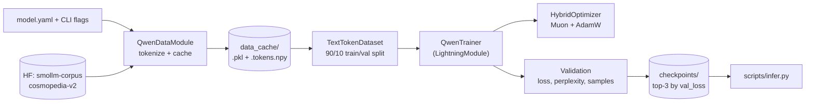

# Qwen3 From Scratch

A small Qwen3-style decoder-only language model trained from scratch with PyTorch Lightning.


- Grouped-query attention with per-head Q/K RMSNorm and rotary position embeddings
- RMSNorm and SwiGLU feed-forward blocks
- Tied token embedding and language-model head
- Hybrid optimizer: Muon for 2D hidden weights, AdamW for embeddings and norms
- Cached tokenization (Cosmopedia-v2, SmolLM tokenizer) and a deterministic train/validation split
- Periodic sample generation during validation, plus a standalone inference script

This is an educational implementation, not an official Qwen3 checkpoint or a reproduction of the
production architecture.

## Requirements

- Linux, Python `>=3.14`, [uv](https://docs.astral.sh/uv/)
- Network access on first run (tokenizer and dataset are downloaded from Hugging Face)
- A CUDA GPU is recommended; CPU works with `--device cpu`

```bash
uv sync
```

## Project Layout

```text
.
├── main.py                       # training entrypoint (CLI)
├── pyproject.toml                # dependencies, ruff config
├── scripts/
│   ├── convert_cache.py          # convert an old pickle token cache to the mmap format
│   └── infer.py                  # interactive / one-shot generation from a checkpoint
├── src/
│   ├── configs/
│   │   ├── model.yaml            # model + training hyperparameters
│   │   ├── model_config.py       # ModelConfig dataclass
│   │   └── logging.py            # loguru setup
│   ├── data/
│   │   ├── tokenizer.py          # TextTokenizer (wraps `tokenizers`)
│   │   ├── dataset.py            # token cache + next-token dataset
│   │   └── dataloader.py         # Lightning DataModule
│   ├── neuralnet/
│   │   ├── qwen.py               # Qwen3LLM
│   │   ├── transformer.py        # TransformerBlock
│   │   ├── attention.py          # GroupedQueryAttention
│   │   ├── feed_forward.py       # SwiGLUFeedForward
│   │   └── rotatory_pos_embed.py # RoPE
│   ├── optim/
│   │   ├── muon.py               # Muon
│   │   └── hybridoptim.py        # HybridOptimizer (Muon + AdamW)
│   └── trainer.py                # LightningModule, generation, metrics
└── tests/                        # pytest suite
```

## Training Pipeline



## Steps to Train Qwen3

1. **Install dependencies**

   ```bash
   uv sync
   ```

2. **Configure the model.** Edit `src/configs/model.yaml`. The shipped values (`d_model: 8`,
   2 layers) are a tiny smoke-test model; raise them for a real run, for example
   `d_model: 512`, `n_heads: 8`, `n_layers: 6`, `d_ff: 1536`, `n_kv_heads: 4`. Also raise
   `num_documents` and `max_tokens` to train on more data. Keep `vocab_size: null`; it is filled
   from the tokenizer.

3. **Run the tests** (fast, no GPU or downloads needed):

   ```bash
   uv run pytest -q
   ```

4. **Train.** The first run downloads the dataset, tokenizes it and writes the cache; later runs
   reuse it.

   ```bash
   uv run python main.py                       # one GPU, config from model.yaml
   uv run python main.py -g 2 -db ddp          # multi-GPU (default backend: deepspeed_stage_2)
   uv run python main.py --precision fp16-mixed  # e.g. T4 GPUs, which lack bf16
   ```

5. **Monitor.** Training logs `train_*` and `val_*` loss, perplexity and accuracy. Every
   `--inference-every` steps (default 100) it samples text from fixed prompts during validation.
   Set `COMET_API_KEY` to also log to Comet.

6. **Resume** from a checkpoint:

   ```bash
   uv run python main.py --resume-checkpoint checkpoints/<name>.ckpt
   ```

7. **Generate** from a trained checkpoint:

   ```bash
   uv run python scripts/infer.py -p "The history of Rome" -n 256
   ```

   The model is a base model: it continues the text you give it.

### CLI flags

| Flag | Default | Purpose |
| --- | --- | --- |
| `-c`, `--config` | `src/configs/model.yaml` | YAML configuration |
| `-g`, `--gpus` | `1` | Number of GPUs |
| `-db`, `--dist_backend` | `deepspeed_stage_2` | Multi-GPU strategy |
| `-d`, `--device` | from yaml | `cpu` or `cuda` |
| `--precision` | bf16 if `use_amp` on CUDA | `32-true`, `bf16-mixed`, `fp16-mixed` |
| `--compile` | off | `torch.compile` the model |
| `--checkpoint-dir` | `checkpoints` | Where checkpoints are written |
| `--resume-checkpoint` | none | Checkpoint to resume from |
| `--cache-dir` | `data_cache` | Tokenized dataset cache |
| `--num-workers` | `0` | DataLoader workers |
| `--inference-every` | `100` | Steps between sample generations |

### Key config fields

| Field | Purpose |
| --- | --- |
| `d_model`, `n_layers`, `d_ff` | Model width, depth, feed-forward size |
| `n_heads`, `n_kv_heads` | Query and key/value heads (GQA) |
| `max_seq_len` | Tokens per training sample |
| `num_documents`, `max_tokens` | Data volume limits |
| `batch_size`, `gradient_accumulation_steps` | Per-device batch and effective batch scaling |
| `max_steps`, `eval_every`, `eval_steps` | Training length and validation schedule |
| `muon_lr` | Muon learning rate (AdamW uses `muon_lr * 0.1`) |
| `weight_decay`, `dropout`, `grad_clip` | Regularization |
| `use_amp`, `device` | Mixed precision and device |

If a GPU runs out of memory, lower `batch_size` or `max_seq_len` and raise
`gradient_accumulation_steps` to keep the effective batch size.

## Data Cache

Tokenization is cached under `data_cache/` as a pickle (texts, tokenizer JSON) plus a
memory-mapped `.tokens.npy` that ranks and DataLoader workers share without copying. Pickle files
can execute code on load; only use caches you created. Convert an older pickle-only cache with
`scripts/convert_cache.py`.

## Tests and Linting

```bash
uv run pytest -q
uvx ruff check . && uvx ruff format .
```
